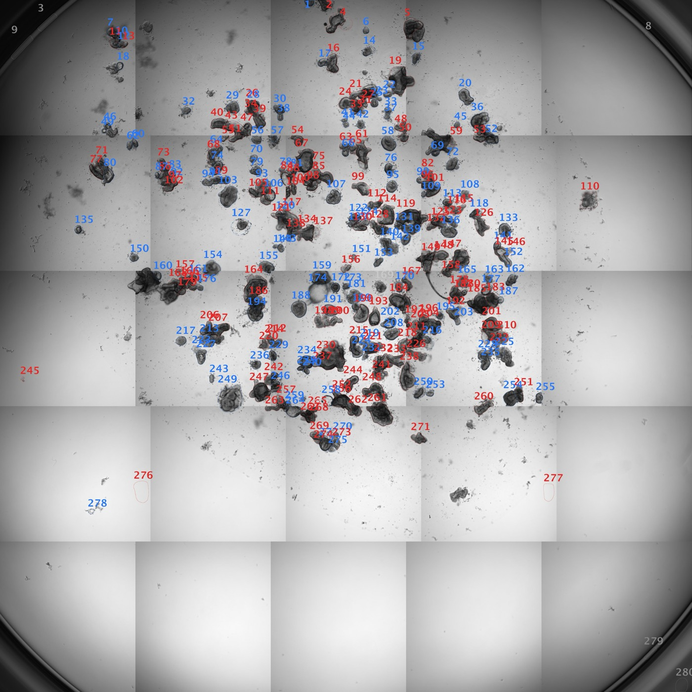
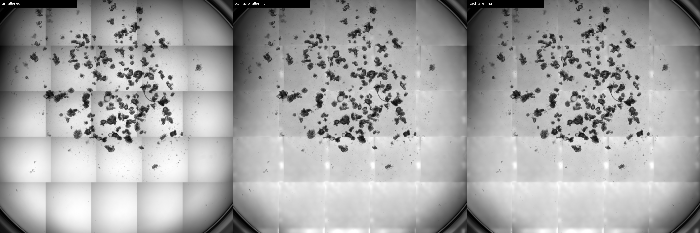

# Organoid morphometry for Fiji

Fiji/ImageJ macros that find every organoid in a whole-well brightfield scan, measure its size and shape, label it, and let a person confirm each label in a few seconds.

Developed by Anish Sharma in the Williams Laboratory, School of Biological Sciences, University of East Anglia (2026).

*A whole-well scan after step 1. Blue outlines are spheroids, red are budded organoids, and each number is the object's row in the CSV.*

## What the macros do

1. Find every organoid in a brightfield image.
2. Measure circumference, diameter, area and shape.
3. Label each object as spheroid (S), budded organoid (O), merged cluster (M) or debris (X).
4. Count each type per image.
5. Let you check and correct the labels one organoid at a time, and mark an object uncertain (U) when you cannot decide.

The automatic labels are a draft, right about 75 to 80 % of the time. Final numbers should come from step 2, after a person has checked every call.

## The routine, plate after plate

1. Open the scene in Fiji and run `Organoid_Analyse_CP.ijm` with the defaults. Cellpose finds the organoids; a well takes about 15 minutes. `Organoid_Analyse.ijm` is the fallback when Cellpose is not set up.
2. Look at `NAME_overlay.png`.
3. Run `Organoid_Review.ijm`. Press OK for correct calls and click the right letter for wrong ones. Choose R for any object whose yellow outline is wrong: draw it yourself and it is re-measured on the spot.
4. When every plate is done, run `Organoid_Collect.ijm` once. It gathers all the `_SCORED.txt` files into one table.

You do not need a separate redraw step or a second person.

## Install (once)

1. Download Fiji (free) from https://fiji.sc. Plain ImageJ will not do, because Fiji is what opens the microscope's `.czi` files.
2. Put `Organoid_Analyse.ijm` and `Organoid_Review.ijm` anywhere on your computer, for example in a folder called `organoid_macros`.
3. To run a macro, use `Plugins > Macros > Run...` and pick the `.ijm` file. Dragging the file onto the Fiji toolbar and pressing Run in the Script Editor also works.

## Step 1: measure everything with `Organoid_Analyse.ijm`

1. In Fiji, choose `Plugins > Macros > Run…` and then `Organoid_Analyse.ijm`.
2. Fill in the form:

| Field | What to put |
|---|---|
| Use the image that is already open in Fiji | Tick this if the image is open already; you can then leave the two input boxes empty. |
| Input folder | The folder containing the images (`.czi`, `.tif`, `.png`, `.jpg`). |
| …or ONE image | Leave blank to analyse the whole folder, or pick one file. |
| Output folder | An empty folder for the results. |
| Pixel size (µm/pixel) | 1.300 for Axio Observer 5×/0.16 exports. **This is the most important number: every size is wrong if it is wrong.** For another microscope, read it in ZEN (Info tab) or in Fiji under `Image > Properties`. |
| Minimum object area | 4000 µm². Anything smaller is ignored as dust. |
| Maximum object area | 1000000 µm². Big merged clusters are kept and labelled M; the edge filter removes the well rim. |
| Flatten tile seams | Ticked. A whole-well scan is a mosaic of tiles, each lit by the same uneven pattern, brighter in the middle and darker at the edges. At the seams the background jumps, and organoids used to be cut by a straight line. The macro finds the tiles row by row (the rows of a scan are offset from each other), works out the shared lighting pattern from the background tiles and divides it out. On the 12 Aug plate this brought the worst seam jump from 26 % of the background down to 14 %; the earlier version, which only scaled whole tiles, made it worse. Untick it only for a single-field image. |
| Rolling ball radius | 150 px. Flattens uneven lighting; leave it. |
| Gap closing | 4 px. Translucent, thin-walled organoids appear as a dark ring with a pale centre. If the ring has a break, the macro used to measure only a crescent or split the organoid into pieces; this step bridges breaks up to about 8 px wide before the centre is filled. Set 0 to switch it off. Raise it to 6 if you still see crescents, or lower it to 2 if neighbouring organoids get joined. |
| Spur removal | 3 px. Strips anything narrower than about 6 px off an outline, such as specks of noise or the line along a tile seam, which would otherwise add a false jag to the circumference. Real buds are much wider and are not affected. Set 0 to switch it off. |
| Also detect pale / see-through parts by their edges (experimental) | Unticked. On 14 Aug #01 it caught pale buds, but on a crowded plate it also joined neighbouring organoids into large "merged" blobs and picked up specks, so the count was wrong. Leave it off unless the plate is sparse, and always check the overlay. The hand redraw handles pale buds instead. |
| Circularity split | 0.65. Below is a budded organoid, above is a spheroid. Leave it; it was re-fitted on 275 human-scored objects from three plates. |
| Merged-cluster area cutoff | 120000 µm². Leave it. |
| Focus cutoff | 0.45. Every object gets a focus score: how steep its edge is relative to its contrast (sharp is about 0.9, soft about 0.2). Below the cutoff it is called F, out of focus, and is not counted. Raise the cutoff to be stricter or lower it to keep more. Contrast is measured against the background in a ring 8 to 30 px around the object, leaving out neighbouring objects, so a crowded organoid is not scored sharper than it is. |
| Exclude objects touching image edge | Ticked. |
| Well-rim cutoff | 0.58. An object whose centre lies further from the image centre than 0.58 of the image width is in a corner outside the well, usually a sliver of the well wall, and is called X automatically. |
| Save ROI set / Save overlay | Ticked. |

3. Click OK. The macro runs through every image by itself.

For each image you get:

| File | Contents |
|---|---|
| `NAME_objects.csv` | One row per organoid with its measurements (opens in Excel). |
| `NAME_ROIs.zip` | The outlines, needed for step 2. |
| `NAME_overlay.png` | The image with every organoid outlined, numbered and coloured. Look at this first to check the detection worked. |
| `SUMMARY_all_images.txt` | One line per image: counts of each type, % organoid, and mean circumference, diameter and area (tab-separated, opens in Excel). |

Overlay colours: blue is spheroid, red is budded organoid, orange is merged cluster, pale grey is out of focus and dark grey is debris. The number beside each object is its row in the CSV.

## Step 1 with Cellpose: `Organoid_Analyse_CP.ijm`

This works like step 1, except that Cellpose (its built-in `cpsam` model) finds the organoids instead of a threshold. The measurements, the focus score, the S/O/M/X/F rules and every output file stay the same, so steps 2 and 3 work unchanged. Compared with the threshold macro on the 12 Aug plate, it finds pale, see-through organoids, splits most touching organoids that used to come out as one merged cluster, and skips blurry ones by itself. It misses a handful of faint organoids (about 8 of 118 on 12 Aug) and still cuts some organoids that straddle a tile seam.

It needs, once: a conda environment called `organoid` with Cellpose installed, and the `cellpose` folder (with `predict_organoid.py` and `merge_seams.py`) next to the macros.

1. Open the plate (one scene) in Fiji. A 16-bit `.czi` scene works, and so does an 8-bit TIFF saved from it.
2. Run `Organoid_Analyse_CP.ijm` from `Plugins > Macros > Run…`, fill in the output folder and leave the rest at the defaults. Two defaults differ from the threshold macro because Cellpose draws smoother outlines:

   | Field | Default | Why |
   |---|---|---|
   | Circularity split | 0.80 | Re-fitted on 3 Nov 2026 on 174 hand-scored S/O organoids from 12 Aug, 14 Aug and XF P1, matched to Cellpose outlines. Agreement is 75 %, with balanced errors: it calls 47 % O where the hand calls give 49 %. The earlier 0.755 agreed 69 % and called far too few organoids (29 % O). Fitted without each plate in turn, the split comes out at 0.80 to 0.82. |
   | Focus cutoff | 0.45, relative | An object is F if its focus score is below 0.45 × the median focus score of its own plate. The log prints the plate median and the resulting cutoff, and the CSV has the ratio in `focus_rel`. A fixed cutoff fails: the XF P1 plate's median score is 0.68 against 1.0 on the 12 and 14 Aug plates, and the old fixed 0.55 threw out 48 of its 77 hand-confirmed organoids. Fitted on the only 6 hand-scored U (blurry) objects that Cellpose outlined, against 190 hand S/O/M, it catches 3 of the 6 and wrongly drops 7 of the 190. Cellpose itself skips most blurry organoids: 18 of the 24 hand-scored U had no Cellpose outline at all. |
   | Stitch objects cut by a tile seam | Ticked | Cellpose still cuts some organoids that straddle a tile seam into two pieces. Afterwards, two objects are merged back into one when they touch along a seam line: their shared border lies within 4 px of the seam and covers at least 30 % of the shorter piece's extent along it. A small chunk sliced off a big organoid is merged, while two different organoids that merely meet near a seam are not. Both numbers are settings. At 3 px one real pair on 12 Aug was lost to a sub-pixel rounding difference, so the default is 4 px. A 2 to 4 px gap allowance and a lower fraction were tested and rejected: no gapped pairs exist, and a lower fraction merges separate organoids. Merged objects have `seam_merged` = 1 in the CSV, and `NAME_seam_merges.png` shows every merged group with its pieces in different colours and the seam as a white line; glance at it to confirm the merges. |
   | Reuse Cellpose masks | Unticked | Tick it to re-run the measuring and the calls on masks already in the output folder, for example to try another cutoff. This skips the 5-minute Cellpose step; the seam stitching is re-run. |

   
   *Left to right: an unflattened mosaic, the old flattening, and the fixed flattening.*

   Tile flattening (fixed 3 Nov 2026): the macro first finds the row seams, then the column seams within each row of tiles, and works out which rows are shifted (the rows of a meander scan are offset by 205 px). Two bugs made this fail on some plates. Row seams were searched for in one brightness profile across the full width, where the steps up and down under offset tiles cancel out, so XF P1 lost two of its four row seams and came out blotchy. And a row whose grid started 1 px off (1842 or 1844) was treated as shifted, so its lighting pattern was applied 205 px out of place (14 Aug, 3 of 5 rows). Both are fixed. The Log now lists every row of tiles with its column seams and whether it is shifted, so a wrong layout is easy to spot: these scans have 5 rows, each with 4 column seams, and rows 2 and 4 are shifted. Re-run plates analysed before the fix with Reuse unticked.

3. Fiji is busy for about 15 minutes per well (5 minutes of Cellpose, the rest measuring); the Log window shows progress. Then look at `NAME_overlay.png` as usual and go on to step 2.

The output folder also gets `NAME_flat_half.tif` (what Cellpose saw: flattened, half size), `NAME_flat_half_cp_masks.tif` (its raw result), `NAME_flat_half_cp_masks_merged.tif` (after seam stitching), `NAME_seam_merges.csv` (every pair of objects that touch along a seam, merged or not, with the shared border length and fraction) and `NAME_seam_merges.png` (a montage of the merged groups). You can delete them once the review is done. The CSV gains two columns: `cp_label`, the object's label in the mask file, and `seam_merged`, which is 1 when the object was stitched together from pieces cut by a tile seam.

## Step 2: check the labels with `Organoid_Review.ijm`

Do this for each image.

1. Run `Organoid_Review.ijm` from `Plugins > Macros > Run…`.
2. Give it the image, its `NAME_ROIs.zip`, its `NAME_objects.csv` and an output folder. Leave "Start at object #" at 0. Use the same pixel size as in step 1 (1.300), which is needed so a redrawn outline is measured in µm.
3. Fiji zooms to organoid 1 and shows a small window with its area, diameter, circularity and the automatic call pre-selected:

   - S, spheroid: round and smooth.
   - O, budded organoid: lobed or budding outline.
   - M, merged cluster: several organoids fused into one blob.
   - X, debris or artefact: dead material, dust, a bubble or a scratch.
   - F, out of focus: a real organoid but too blurred to score; not counted.
   - U, uncertain: you cannot tell.
   - B, back one: go back and change the previous answer.
   - R, redraw: the yellow outline is wrong (it misses a pale bud, is cut by a tile seam or has a spur). Draw the whole outline with the freehand or oval tool and click OK; the object is re-measured and comes back for its call. Clicking OK without drawing keeps the old outline.

   If the guess is right, press OK (or Enter). Otherwise click the correct button, then OK.
4. Keep going until the last organoid. The results are saved automatically.

To pause, tick "save and stop here" on any object, or close the window. Progress is saved after every click, so nothing is lost. To continue later, run the macro again with `NAME_objects_REVIEWED.csv` as the object table instead of `NAME_objects.csv`; it picks up at the first organoid you have not done.

You get:

| File | Contents |
|---|---|
| `NAME_objects_REVIEWED.csv` | The same as `_objects.csv` plus your answers in `your_call`; redrawn objects carry their new measurements. |
| `NAME_ROIs_REVIEWED.zip` | The outlines, with your redrawn ones replacing the macro's. |
| `NAME_SCORED.txt` | The final counts and percentages from your answers; mean circumference overall, for spheroids and for budded organoids; how many outlines were redrawn; and whether the review is COMPLETE. |

Report the `_SCORED.txt` numbers, not the automatic `auto_call`.

## Shortcut: score from contact sheets with `Organoid_Sheets.ijm`

If clicking through 100 objects in step 2 is too slow, or you want a second person to score them from pictures:

1. Run `Organoid_Sheets.ijm` with the image, its `NAME_ROIs.zip`, its `NAME_objects.csv` and an output folder.
2. It writes `NAME_sheet_1.jpg`, `NAME_sheet_2.jpg` and so on, with 25 objects per sheet, each cropped, outlined in yellow and labelled with its number, automatic call and diameter.
3. Score each number S, O, M, X or U on paper or in a text file. Type the calls into the `your_call` column of the CSV, or enter them with step 2, which still works as before.

## Step 3: one table for all plates with `Organoid_Collect.ijm`

Run `Organoid_Collect.ijm` and choose the folder that holds all your output folders. It writes `ALL_PLATES_scored.txt` there, with one row per image giving the counts, percentages and mean circumferences from every `_SCORED.txt`. It opens in Excel (tab-separated).

## Training your own Cellpose model

`cellpose/Organoid_Export.ijm` turns one reviewed plate into Cellpose training tiles. `cellpose/train_organoid.py` trains a model on those tiles, holds out 20 % as a test set and prints the average precision at IoU 0.5 on it. `cellpose/predict_organoid.py` runs a model on one image, preparing it the same way as the training tiles.

## What the CSV columns mean

| Column | Meaning |
|---|---|
| `Area` | Area of the organoid, µm². |
| `Circumference_um` (same as `Perim.`) | Length around the outline, µm. |
| `EquivDiam_um` | Diameter of a circle with the same area, µm (the "size"). |
| `Circ.` | Circularity, 0 to 1; 1 is a perfect circle, and lobed or budded shapes score low. |
| `Solidity` | How filled-in the shape is, 0 to 1; low means ragged or lobed. |
| `AR` | Aspect ratio (long axis ÷ short axis). |
| `Feret` | Longest distance across the organoid, µm. |
| `X`, `Y` | Position of the centre in the image, µm. |
| `focus_score` | Edge sharpness relative to contrast; sharp is about 0.9, out of focus about 0.2. |
| `auto_call` | The automatic label: S, O, M, X or F. |
| `your_call` | Your label from step 2: S, O, M, X, F or U (blank means not reviewed yet). |

## How the automatic call is made

The rules are applied in this order to every object:

1. Centre further than 0.58 × image width from the image centre: X (well wall).
2. Aspect ratio above 4, or solidity below 0.45: X (fibre, thread or ragged debris).
3. Focus score below 0.45: F, out of focus and not counted. The Cellpose macro uses 0.45 × the plate's median focus score.
4. Area at least 120 000 µm² and solidity below 0.80: M, merged cluster.
5. Area below 6 000 µm² and circularity below 0.25: X, likely debris.
6. Circularity below 0.65: O, budded organoid.
7. Otherwise: S, spheroid.

The 0.65 split was fitted on 275 spheroid and budded calls made by eye on three whole-well plates (12 Aug, 14 Aug, XF lipid P1). It agrees with the human calls 82 % of the time; the old 0.505 managed 75 %. Merged clusters are the weakest call, because big budded organoids and real clusters overlap in every shape measure, so expect to correct some M and O calls in step 2.

## Things to be careful about

- Check the overlay image before anything else. If outlines miss organoids, cut them in half or include background, fix the pixel size or the minimum and maximum area and run step 1 again.
- A partial outline, such as a crescent on a see-through organoid or an outline that stops at the dark body and leaves a pale bud outside, means the rim was too faint or broken for the macro. Give it the call you can see (S or O) and redraw it with R in step 2 so its circumference is right, or raise the gap-closing setting and run step 1 again.
- Seams between microscope tiles, where the background brightness jumps in a straight line, can give an outline a straight edge or a spur. Tile flattening removes most of the jump and spur removal takes off thin spurs; an organoid still cut in two needs the hand redraw.
- The macro cannot split merged clusters. At late timepoints, when organoids fuse, counts will be too low. If you need exact numbers there, draw the separate organoids by hand in the ROI Manager before step 2.
- Circumference reads a few percent high, because it follows the pixel staircase of the outline. That is fine for comparing conditions; mention it if you report absolute values.
- Use the original `.czi` or `.tif`, not JPEG, because JPEG compression creates false edges.
- The thresholds were calibrated on images downsampled 4×. The macro runs on full-resolution images, so the spheroid and organoid split may behave slightly differently, which is another reason the human check matters.
- The pipeline is single-plane 5× brightfield, with a depth of field of about 43 µm, so thick organoids are partly out of focus. "Uncertain" is a real answer.

## Licence

MIT. See [LICENSE](LICENSE).
